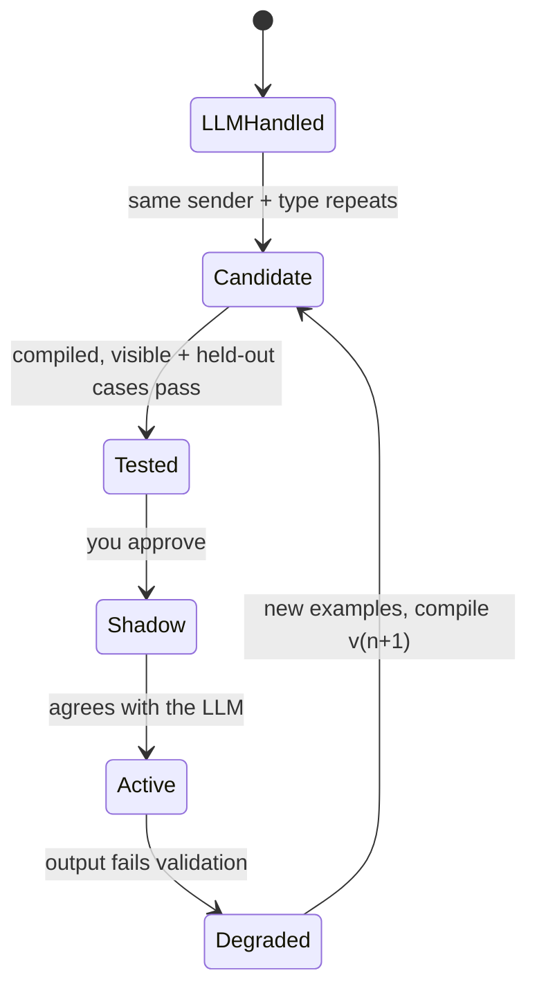

# Sorted

A personal assistant that learns your patterns and turns them into compiled, tested code.

Most AI assistants send every request to an LLM, every time. That costs money on every message, adds latency, and
means your bank statements, bills and appointments leave your machine forever. Sorted uses the LLM to **learn**,
not to run. When it sees a task for the first time, an LLM solves it. When the same kind of task keeps coming
back, Sorted writes a small Python skill for it, tests that skill against real examples, and switches to it. From
then on that task runs locally, with zero LLM calls.

The result is an assistant that gets better the longer you use it:

- **Cheaper:** repeated work stops costing tokens.
- **More private:** once a skill is compiled, that kind of message never reaches a model provider again.
- **Personal:** the skills are learned from *your* messages, senders and questions, not from a generic template.
- **Inspectable:** every skill is plain Python with its own test cases, which you approve before it goes live.

The first domain is household admin: bills, renewals, subscriptions, appointments, medicines and meeting
requests that arrive by email, SMS and PDF. The learning loop itself isn't tied to that domain.

## How it learns

1. **First time:** an LLM agent reads the message (already redacted) and extracts typed fields such as type,
   provider, amount and due date. The result is checked and saved as a *trace*.
2. **Pattern spotted:** once the same sender and message type repeat (3 times by default), the message type
   becomes a candidate for a skill.
3. **Skill written:** a compiler agent writes a Python parser from those traces. Some cases are held back and never
   shown to it.
4. **Skill tested:** the code must pass a static check (an import allowlist, no file or network access) and then
   run in a sandbox against the examples it saw and the ones it didn't. It gets one retry with the failures fed
   back.
5. **You approve:** nothing goes live without your OK. After approval, the skill runs in *shadow mode* next to the
   LLM, which still provides the answer, until the two agree.
6. **Skill takes over:** the skill handles those messages locally from then on.
7. **Self-repair:** if a sender changes its format, the skill's output fails validation. Sorted falls back to the
   LLM, collects new examples and compiles version 2.



The same loop applies beyond parsing messages:

- **Questions:** "Any doctor appointments this month?" first goes to the LLM, which turns it into a typed query.
  Fixed code then answers it. Ask the same kind of question a few times and Sorted compiles a recogniser, so the
  next one needs no LLM call.
- **New kinds of messages:** when something doesn't fit a known type (supplier shipment requests, say), Sorted
  notices it repeating and asks whether to learn it. If you agree, it compiles a parser for it and runs a fixed,
  safe action each time one arrives.
- **Noise:** a local classifier (TF-IDF + logistic regression), retrained on the LLM's labels, filters out
  promotions and newsletters before they reach the LLM.

Reminders, rules (price increases, medicine refills) and scheduling never use an LLM.

For the full design, see the [technical document](docs/ARCHITECTURE.md).

## Results

Measured on a synthetic dataset of six months of household mail (81 messages) in
[`data/samples/`](data/samples). Full output is in [`reports/demo_run.md`](reports/demo_run.md) and
[`reports/eval.md`](reports/eval.md).

| Month | Messages | Handled by compiled skills | LLM calls | Privacy score |
|---|---|---|---|---|
| 1 | 10 | 0 | 10 | 0% |
| 2 | 12 | 0 | 12 | 0% |
| 3 | 15 | 1 | 23 | 7% |
| 4 | 12 | 0 | 13 | 0% |
| 5 | 13 | 8 | 7 | 62% |
| 6 | 15 | 7 | 9 | 47% |

- **Month 3:** skills are compiled, so it has the most LLM calls.
- **Month 4:** the skills run in shadow next to the LLM.
- **Month 5:** they take over.
- **Month 6:** a bank changes its email layout. Its skill fails, falls back to the LLM and is recompiled as v2.
  Month 6 also brings new kinds of messages, which the LLM handles first.
- **Compiled skills:** 11 parser versions, each passing all of its held-out cases. The code and tests are in
  [`abilities/`](abilities).
- **Extraction accuracy:** 100% on type, provider and due date, and 98.6% on amount. The data is
  template-generated, so a real inbox will be harder.

## Getting started

You need Python 3.12 and [uv](https://docs.astral.sh/uv/). Sorted runs on Linux, macOS and Windows.

```bash
git clone https://github.com/Aryannnthakurrr/sorted.git
cd sorted
make setup   # install dependencies, create .env and the SQLite database
make demo    # replay six simulated months, no API key needed
make test    # offline test suite
```

On Windows without `make`, run the commands it wraps:

```powershell
uv sync
copy .env.example .env
uv run brain init
uv run python -m brain.demo      # make demo
uv run python -m brain.web       # make sim
uv run pytest -q                 # make test
```

`make demo` replays LLM responses recorded during a live run (in [`data/llm_cache/`](data/llm_cache)), so it
runs without any API key. To use live models, set `OPENAI_API_KEY` and/or `CEREBRAS_API_KEY` in `.env` and run
`make demo-live`. Either key works alone: each route falls back to the other provider.

### Configuration

Everything is set in `.env`. [`.env.example`](.env.example) lists every option. The main ones:

| Variable | Purpose |
|---|---|
| `OPENAI_API_KEY`, `CEREBRAS_API_KEY` | LLM providers. The small route (extraction, chat) defaults to Cerebras `gpt-oss-120b`; the strong route (writing skills) defaults to OpenAI `gpt-5.4` |
| `BRAIN_COMPILE_AFTER` | How many repeats before a skill is compiled (default 3) |
| `BRAIN_SHADOW_RUNS` | How many shadow runs must agree with the LLM before a skill goes live (default 2) |
| `BRAIN_RUN_TOKEN_BUDGET`, `BRAIN_DAY_TOKEN_BUDGET` | Token limits. Over budget, messages are queued, not dropped |
| `IMAP_HOST`, `IMAP_USER`, `IMAP_PASSWORD` | Read-only email ingestion (for Gmail, use an app password) |
| `TELEGRAM_BOT_TOKEN` | Optional Telegram interface |
| `BRAIN_MCP_TOKEN` | Bearer token for the MCP server over HTTP |

## Interfaces

The assistant's core is a library (`brain/`). The interfaces below are thin front ends over it, and you can add
others the same way.

### Command line

```bash
uv run brain ingest path/to/mail.eml      # run an .eml or .pdf through the pipeline
uv run brain imap --since 2026-10-01      # pull from your inbox
uv run brain due                          # what's due in the next 7 days
uv run brain ask "When does my car insurance expire?"
uv run brain say "Track Mom's thyroid tablet, 1 every morning, 30 left"
uv run brain abilities                    # compiled skills and their health
uv run brain approve <name>               # approve a tested skill
uv run brain score                        # privacy score: share of work done by compiled skills
```

### Web dashboard and simulation

```bash
make sim
```

This opens a dashboard at http://127.0.0.1:8000 that plays the synthetic household on a simulated clock. You can
watch messages arrive, skills get compiled and approved, the share of local work grow, and a skill break and
repair itself. **Run full demo** plays all six months on autopilot. You can also add your own messages, or
describe new ones for the LLM to generate.

### Telegram (example chat interface)

```bash
make bot
```

This is a reference chat front end. It shows reminders, approval buttons and replies such as `paid` or `done`, and
it answers questions. The first chat to send `/start` becomes the owner, or you can set `TELEGRAM_OWNER_ID`. If
`TELEGRAM_BOT_TOKEN` is set, `make sim` uses it too.

### MCP server

Any MCP client (Claude Desktop, Cursor and others) can query Sorted's state with tools such as `get_upcoming`,
`search_obligations`, `mark_paid` and `create_reminder`.

```json
{
  "mcpServers": {
    "sorted": {
      "command": "uv",
      "args": ["--directory", "/absolute/path/to/sorted", "run", "python", "-m", "brain.mcp_server"]
    }
  }
}
```

For remote clients, `make mcp-http` serves Streamable HTTP at `http://127.0.0.1:8765/mcp`. It requires
`Authorization: Bearer $BRAIN_MCP_TOKEN`, and `BRAIN_MCP_SCOPE=read` turns off the write tools.

### SMS webhook

`uv run brain serve-sms` accepts `POST /ingest/sms` with a JSON body `{"sender": ..., "body": ...}` and a per-user
bearer token from `BRAIN_INGEST_TOKENS`, so an SMS forwarder on your phone can post messages to it.

## Safety and privacy

- **Redaction:** card numbers, account numbers, phone numbers and email addresses are masked inside the LLM
  wrapper before every call, so no code path can skip it. OTPs are dropped before anything is stored.
- **No dangerous tools:** no agent can pay, forward, delete or message anyone else. The only outgoing message is
  a meeting reply that you press Send on.
- **Restricted skill code:** compiled skills may import only `re`, `datetime`, `decimal`, `html`, `json` and
  `dateutil`. They run in a separate process with no environment variables (so no API keys), with networking
  disabled, and with a timeout. On Linux and macOS they also get CPU and file-size limits.
- **Approval and audit:** no skill goes live without your approval, and every write is recorded in an audit
  log.
- **Local data:** `.env` and the database are git-ignored. All sample data is synthetic.

## Project layout

| Path | Contents |
|---|---|
| `brain/orchestrator.py` | Routes each message: compiled skill, local classifier or LLM agent |
| `brain/compiler/` | Pattern detector, skill generator, static check, sandbox, skill registry |
| `brain/query.py`, `brain/skills.py` | Compiled questions; new message categories becoming skills |
| `brain/llm.py` | LLM wrapper: two routes, redaction, budgets, cost tracking, record/replay |
| `brain/agents.py`, `brain/planner.py` | Extraction, chat and planning agents |
| `brain/ml/` | Local classifier and training |
| `brain/rules/`, `brain/scheduler.py` | YAML rules and reminders |
| `brain/sources/` | Adapters for IMAP, SMS webhook, PDF and test fixtures |
| `brain/web/`, `brain/telegram_bot.py`, `brain/mcp_server.py`, `brain/cli.py` | Interfaces |
| `abilities/` | Skills compiled during the demo run, with their tests |
| `data/samples/` | Synthetic dataset |

## Development

```bash
make test    # offline test suite (LLM and HTTP calls are mocked)
make lint    # ruff
make eval    # re-score the last demo run
make train   # retrain the local classifier
uv run pytest abilities   # run the compiled skills' own tests
```

## Roadmap

**More useful to the person using it**
- Learn habits as well as formats. If you always pay a card bill two days before it's due, the reminder should
  move to match.
- Spot money problems: a bill much higher than usual, a duplicate charge, a subscription you haven't used, a
  renewal priced above last year's.
- A monthly picture of where the money goes, built from the bills and receipts Sorted already reads.
- A document vault with expiry tracking (passport, licence, insurance, PUC), with reminders well before deadlines.
- Real calendar integration (Google and Outlook) for appointments and accepted meetings.
- Family mode: shared obligations and medicines across a household, with per-person views.
- Skills that act as well as read: drafting a reply, filling a form, or preparing a payment for you to confirm.
- Fully offline mode with a local model (for example through Ollama), so even the learning step stays on your
  machine.
- Share skill code without sharing data: a library of verified parsers for common senders, so a new user starts
  with skills already compiled.

**Better sandboxing for newly written skills**
- Run skills in WebAssembly (for example CPython on Wasmtime) for one strong, cross-platform sandbox with no
  file system or network by default, the same on Linux, macOS and Windows.
- Until then, use OS-level isolation per platform: seccomp and namespaces on Linux, Job Objects with CPU and memory
  limits on Windows, `sandbox-exec` on macOS.
- Per-skill capabilities declared in the skill and enforced at run time, instead of one shared allowlist.
- Fuzz and property-test each new skill with mutated inputs before approval, in addition to the held-out cases.
- Sign approved skill versions, so a skill can't be changed on disk after you approve it.
- Keep comparing a sample of a live skill's outputs with the LLM over time, to catch silent drift.
