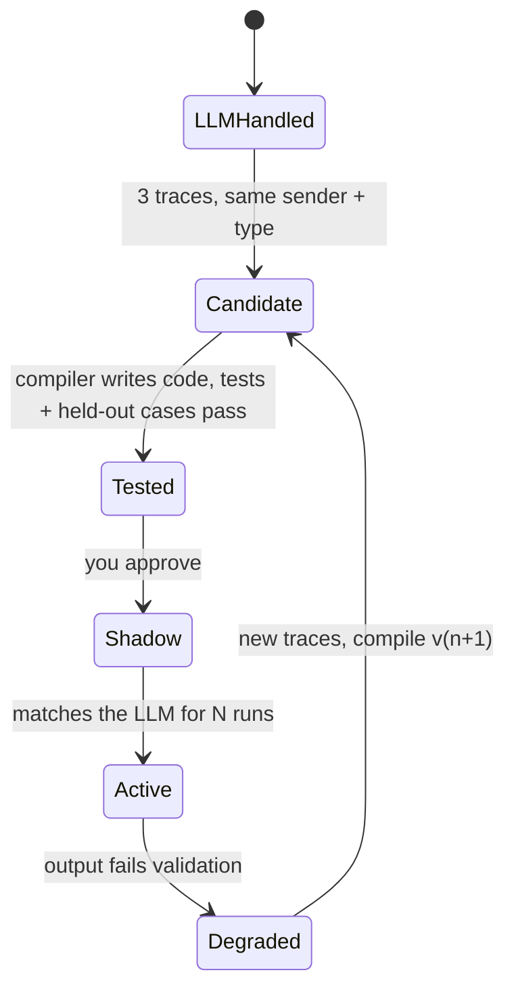

# Sorted

A self-hosted household admin assistant that uses AI as a compiler, not an interpreter.

Sorted reads your bills, renewals, appointments and reminders from email, SMS and PDFs, and keeps track of what's
due. It uses an LLM only while a kind of message is new. Once the same kind keeps arriving, Sorted writes a small
Python parser for it, tests it, and switches to that code. Over time it gets cheaper, faster and more private,
because fewer messages ever reach a model.

## How it works

1. **A message comes in** from email (IMAP), an SMS webhook, a PDF, a web page or Telegram. OTPs are dropped
   before anything is stored, and personal details (card and account numbers, phones, emails) are redacted.
2. **If a compiled parser matches it**, the parser runs in a sandbox with no LLM call.
3. **Otherwise** a local classifier (TF-IDF + logistic regression) filters out obvious noise. The rest goes to an
   LLM agent that extracts typed fields: type, provider, amount and due date. Every LLM solve is saved as a trace.
4. **Once the same sender and message type repeat** (3 times by default), a compiler agent writes a parser and
   tests from those traces.
5. **The parser has to earn its place.** It must pass an AST allowlist check, its own tests and held-out cases in
   the sandbox. Then you approve it, and it runs in shadow next to the LLM before it takes over.
6. **If a provider changes its email layout**, validation fails and the message falls back to the LLM. Sorted
   collects new traces and compiles version 2.

Reminders, YAML rules (price increases, medicine refills) and scheduling run without any LLM. Repeated chat
questions get compiled the same way as messages.



## Results

Measured on a synthetic dataset of six months of household mail (81 messages) in
[`data/samples/`](data/samples). Full output is in [`reports/demo_run.md`](reports/demo_run.md) and
[`reports/eval.md`](reports/eval.md).

| Month | Messages | Handled by local code | LLM calls | Privacy score |
|---|---|---|---|---|
| 1 | 10 | 0 | 10 | 0% |
| 2 | 12 | 0 | 12 | 0% |
| 3 | 15 | 1 | 23 | 7% |
| 4 | 12 | 0 | 13 | 0% |
| 5 | 13 | 8 | 7 | 62% |
| 6 | 15 | 7 | 9 | 47% |

- Month 3 is when the parsers are compiled, so it has the most LLM calls. Month 4 runs them in shadow.
- In month 6 the bank changes its email layout. The v1 parser fails, the message falls back to the LLM, and v2 is
  compiled.
- Extraction accuracy is 100% on type, provider and due date, and 98.6% on amount. The data is template-generated,
  so a real inbox will be harder.
- When the local classifier is confident (82.6% of messages), it is right every time. Anything below the
  threshold goes to the LLM.

## Getting started

You need Python 3.12 and [uv](https://docs.astral.sh/uv/). Sorted runs on Linux, macOS and Windows.

```bash
git clone https://github.com/Aryannnthakurrr/sorted.git
cd sorted
make setup   # install dependencies, create .env and the SQLite database
make demo    # replay six simulated months, no API key needed
```

On Windows without `make`, run the commands it wraps:

```powershell
uv sync
copy .env.example .env
uv run brain init
uv run python -m brain.demo      # make demo
uv run python -m brain.web       # make sim
uv run python -m brain.telegram_bot   # make bot
uv run pytest -q                 # make test
```

On Windows the code sandbox can't set CPU and file-size limits, so it relies on the timeout and the static check.

`make demo` replays recorded LLM responses from [`data/llm_cache/`](data/llm_cache), so it runs offline. To use
live models, set `OPENAI_API_KEY` and/or `CEREBRAS_API_KEY` in `.env` and run `make demo-live`. Either key works
alone: each route falls back to the other provider.

### Configuration

Everything is set in `.env`. [`.env.example`](.env.example) lists every option. The main ones:

| Variable | Purpose |
|---|---|
| `OPENAI_API_KEY`, `CEREBRAS_API_KEY` | LLM providers. The small route (extraction, chat) defaults to Cerebras `gpt-oss-120b`; the strong route (writing code) defaults to OpenAI `gpt-5.4` |
| `TELEGRAM_BOT_TOKEN` | Telegram bot, from @BotFather |
| `IMAP_HOST`, `IMAP_USER`, `IMAP_PASSWORD` | Read-only email ingestion (for Gmail, use an app password) |
| `TINYFISH_API_KEY` | Web page fetching and portal automation |
| `BRAIN_MCP_TOKEN` | Bearer token for the MCP server over HTTP |
| `BRAIN_COMPILE_AFTER` | How many repeats before a parser is compiled (default 3) |

## Usage

### Command line

```bash
uv run brain ingest path/to/mail.eml      # run an .eml or .pdf through the pipeline
uv run brain say "Track Mom's thyroid tablet, 1 every morning, 30 left"
uv run brain due                          # what's due in the next 7 days
uv run brain ask "When does my car insurance expire?"
uv run brain abilities                    # compiled parsers and their health
uv run brain approve <name>               # approve a tested parser
uv run brain score                        # privacy score
uv run brain imap --since 2026-10-01      # pull from your inbox
uv run brain fetch <url>                  # pull a web page into the pipeline
```

### Telegram bot

```bash
make bot
```

The first chat to send `/start` becomes the owner, or you can set `TELEGRAM_OWNER_ID`. Commands include `/due`,
`/score`, `/abilities`, `/approve <name>` and `/audit`. You can reply `paid` or `done` to a reminder, send PDFs, or
ask questions in plain text. Reminders survive restarts and respect quiet hours (`BRAIN_QUIET_HOURS`).

### Web dashboard and simulation

```bash
make sim
```

This opens a dashboard at http://127.0.0.1:8000 that plays the synthetic household on a simulated clock. You can
watch mail arrive, reminders fire, parsers get compiled and approved, and the share of local code grow. **Run
full demo** (or `/run` in Telegram) plays all six months on autopilot. You can also add your own synthetic
messages or describe new ones for the LLM to generate.

### MCP server

Sorted exposes its state to any MCP client (Claude Desktop, Cursor and others), with tools such as
`get_upcoming`, `search_obligations`, `mark_paid` and `create_reminder`.

```json
{
  "mcpServers": {
    "sorted": {
      "command": "uv",
      "args": ["--directory", "/absolute/path/to/sorted", "run", "python", "-m", "brain.mcp_server"]
    }
  }
}
```

For remote clients, `make mcp-http` serves Streamable HTTP at `http://127.0.0.1:8765/mcp`. It requires
`Authorization: Bearer $BRAIN_MCP_TOKEN`, and `BRAIN_MCP_SCOPE=read` turns off the write tools.

### SMS webhook

`uv run brain serve-sms` accepts `POST /ingest/sms` with a JSON body `{"sender": ..., "body": ...}` and a per-user
bearer token from `BRAIN_INGEST_TOKENS`. You can point an iPhone Shortcut or an Android forwarder at it.

## Safety and privacy

- Redaction runs inside the LLM wrapper before every call, so no code path can skip it.
- No agent has a tool to pay, forward, delete or message anyone else. The only outgoing message is a meeting
  reply you approve yourself.
- Generated code can only import a small allowlist (`re`, `datetime`, `decimal`, `json`, `dateutil` and a few
  others). It runs in a separate process with no environment variables, no network, and CPU and time limits.
- No parser goes live without your approval. Every write is recorded in an audit log.
- `.env` and the database are git-ignored. All sample data is synthetic.

## Project layout

| Path | Contents |
|---|---|
| `brain/sources/` | Adapters for IMAP, SMS webhook, PDF, TinyFish and test fixtures |
| `brain/llm.py` | Two-route LLM wrapper: redaction, budgets, cost tracking, record/replay |
| `brain/agents.py`, `brain/orchestrator.py` | Extraction and chat agents, message routing |
| `brain/compiler/` | Pattern detector, code generator, AST check, sandbox, parser registry |
| `brain/ml/` | Local classifier and training |
| `brain/rules/` | YAML rules |
| `brain/scheduler.py`, `brain/telegram_bot.py` | Reminders and the bot |
| `brain/mcp_server.py` | MCP server |
| `brain/web/`, `brain/sim.py` | Dashboard and simulation |
| `abilities/` | Parsers compiled during the demo run, with their tests |
| `data/samples/` | Synthetic dataset |

## Development

```bash
make test    # offline test suite (LLM and HTTP calls are mocked)
make lint    # ruff
make eval    # re-score the last demo run
make train   # retrain the local classifier
```

## Roadmap

- Run against a real inbox and measure accuracy there
- Docker-based sandbox for compiled code
- Compile TinyFish portal runs into replayable browser scripts
- Google Calendar events for reminders and meetings
- Android SMS app and iPhone Shortcut
- Encryption at rest, OCR for photos, WhatsApp reminders

## Credits

Built by Team Not Found (Anish Manchanda, Aryan Thakur, Keshav Goel) at HackIIITD 2026, IIIT Delhi.
