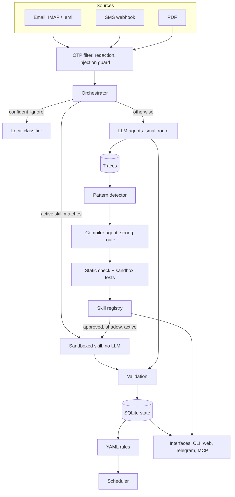
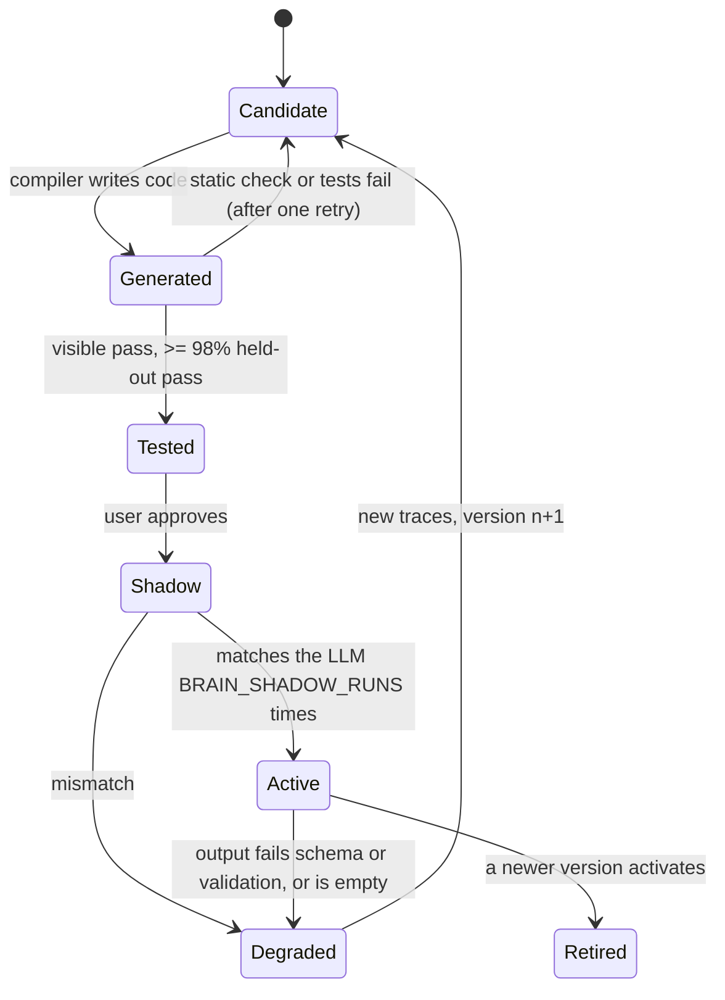

# Sorted: technical design

This document explains how Sorted works internally: how a message flows through the system, how repeated LLM work
becomes compiled skills, how those skills are checked and kept honest, and where the security boundaries are.
File references point into `brain/`.

## 1. The core idea

An LLM is a general solver that is expensive per call. Most of what a personal assistant handles is repetitive:
the same bank sends the same statement layout every month, and the same kinds of questions come back. Sorted treats
the LLM as a **compiler** for that repetition:

```text
new task ──► LLM solves it ──► trace saved
                                  │  (same pattern repeats)
                                  ▼
                       compiler agent writes code
                                  │
                       static check + sandbox tests
                                  │
                       user approval + shadow runs
                                  ▼
             compiled skill handles the task locally, 0 LLM calls
                                  │  (input changes, output fails validation)
                                  ▼
                       fall back to LLM, recompile v(n+1)
```

Every compiled skill ("ability" in the code) is ordinary Python, stored with its test cases. The share of work
done by skills is reported as the **privacy score**.

## 2. Components



| Module | Role |
|---|---|
| `messages.py`, `sources/` | Normalise every input into one `Message` (kind, sender, subject, body, received time) |
| `filters.py`, `redact.py` | Drop OTPs, flag prompt-injection text, mask personal identifiers |
| `orchestrator.py` | Decide who handles a message, then validate, store, apply rules and record a trace |
| `llm.py` | The only way to call a model: routes, redaction, JSON validation, budgets, cost, record/replay |
| `agents.py`, `planner.py` | Inbox, Document and Chat agents; the Planner turns "track my tablets" into schedules |
| `compiler/detector.py` | Group traces into patterns and create skill candidates |
| `compiler/generator.py` | The compiler agent: prompt, test-case split, retry loop, export |
| `compiler/static_check.py` | AST allowlist applied to generated code before it runs |
| `compiler/sandbox.py` | Subprocess runner for generated code |
| `compiler/registry.py` | Runtime lifecycle: match, execute, shadow, activate, degrade, approve |
| `query.py` | The same loop for chat questions |
| `skills.py` | New message categories, proposed to the user as new skills |
| `ml/` | Local two-layer classifier |
| `rules/`, `scheduler.py`, `replies.py` | Deterministic rules, reminders and reply handling |
| `state.py`, `validate.py`, `db.py` | Extraction schema and checks, state updates, the data model |

## 3. Message lifecycle

`Orchestrator.ingest()` in `orchestrator.py`:

1. **OTP filter.** One-time passwords are dropped before storage. Only the fact that one was dropped is audited.
2. **Deduplication.** A hash of the body is checked against `source_records`, so the same message isn't
   processed twice.
3. **Redaction.** The stored text is redacted (`redact.py`). Card numbers keep their last 4 digits, account and
   policy numbers keep their last 4, and phones and emails are masked. LLM agents and compiled skills both see
   only this redacted text, so they agree on their inputs.
4. **Injection guard.** Text that looks like an instruction to the model is marked `ignore` and never reaches an
   LLM.
5. **Routing** (`_extract`):
   - An **active** skill whose trigger matches runs in the sandbox. If its output passes validation, it is the
     answer, at no LLM cost. If not, the skill is *degraded* and the message falls through to the LLM.
   - With no skill, the **local classifier** may confidently label the message `ignore`.
   - Otherwise the **Inbox agent** (email) or **Document agent** (SMS, PDF) extracts fields with the small LLM
     route. If a **shadow** skill matches, it runs alongside and is compared, but the LLM's answer is used.
6. **Validation** (`validate.py`). The result must be a valid `Extraction`. Bills need an amount above 0, a
   provider must be present, and the due date must fall between 45 days before and 400 days after receipt.
   Failures are recorded and the trace is marked not accepted.
7. **State** (`state.py`). Obligations, subscriptions, documents and meetings are updated. Duplicates (a bank's
   email and its SMS) are linked. Conflicts (two different premiums for one renewal) are flagged, never
   overwritten.
8. **Rules and reminders.** YAML rules run, relative reminders are scheduled ("3 days before due"), and meeting
   requests prompt the user. None of this uses an LLM.
9. **Trace.** A row in `traces` records the handler (`llm`, `ability:<name>@v<n>`, `ml:<layer>` or `rule:...`),
   tokens, cost and output. Traces are the training data for the compiler.

## 4. From traces to skills

### 4.1 Detecting a pattern (`compiler/detector.py`)

Accepted LLM extraction traces are grouped by `(source kind, sender key, message type)`. For a new kind of message
(type `other`), the LLM's category label stands in for the type. A group with at least `BRAIN_COMPILE_AFTER`
traces (default 3) becomes a **candidate** skill named after the group, for example `hdfcbank_net_bill_due`.

Each candidate gets a **trigger**: the source kind, the sender key and, for email, the subject words shared by all
examples (dates, months and redaction masks excluded). At run time a skill only sees messages its trigger
matches.

### 4.2 Writing the code (`compiler/generator.py`)

1. **Split cases.** About 30% of the examples are held out and never shown to the compiler. The split is
   deterministic per skill version. During a repair, the examples that broke the old version are always visible.
2. **Prompt.** The strong-route model gets the visible examples (input text, expected JSON) and a strict contract.
   It must define `extract(text) -> dict` with exactly the output fields, as a pure function. It may import only
   `re`, `datetime`, `decimal`, `html`, `json` and `dateutil`. It must anchor on labels rather than values, and
   raise `ValueError` when a label is missing instead of guessing.
3. **Static check** (`compiler/static_check.py`). The AST is walked and rejected for any import outside the
   allowlist, any banned name (`open`, `eval`, `exec`, `getattr`, `os`, `sys`, `socket` and others), any dunder
   attribute or name, `global` or `nonlocal`, or a missing `extract`.
4. **Sandbox tests.** The code runs on every case. Numbers must match within 0.01, providers by token overlap,
   other strings case-insensitively.
5. **Decision.** The skill becomes **tested** only when every visible case passes and at least 98% of held-out
   cases pass. Otherwise the failures (and a count of held-out failures, without the cases themselves) are fed
   back for **one** retry. If that fails too, the skill stays a candidate and is retried when more examples
   arrive.
6. **Export.** Tested skills are written to `abilities/<name>/v<n>/` as `ability.py`, `cases.json` and a
   standalone `test_ability.py`, so they can be read and rerun with `uv run pytest abilities`.

The generated file starts with a header holding `TRIGGER`, `PERMISSIONS` and `OUTPUT_FIELDS`, so a skill is
self-describing.

### 4.3 Earning trust (`compiler/registry.py`)



- **Approval** is the human gate. Nothing moves past `tested` without the user, whether through `brain approve`,
  a dashboard button or a Telegram button.
- **Shadow mode** runs the skill on live messages next to the LLM and compares the core fields (type, provider,
  amount, due date). After `BRAIN_SHADOW_RUNS` agreements (default 2) it becomes active. One mismatch degrades it.
- **Active skills are checked on every run.** Their output must parse as an `Extraction` and pass validation. A
  failure degrades the skill, falls back to the LLM, and records the message as the point to repair from.
- **Repair.** Once new LLM traces exist after a skill broke, the detector creates version n+1 from old and new
  examples, with the new layout always visible. The old version is kept for reference and retired when the new
  one activates.

## 5. Compiled questions (`query.py`)

Chat follows the same loop, with a split between understanding and answering:

1. The LLM never answers from raw data. It only turns the question into a typed `QuerySpec`:
   `{intent, period, provider, start, end}`. Intents include `due_items`, `appointments`, `subscriptions`,
   `documents`, `medicines`, `price_changes` and `digest`.
2. Fixed, read-only code (`answer_for`) runs that spec against the state and fills an answer template.
3. Questions with the same intent are grouped. After enough of them, the compiler writes a **recogniser**
   (question → `QuerySpec`). It is tested on positive examples and on other intents' questions it must *not*
   claim.
4. After approval and shadow runs, a single matching active recogniser answers with no LLM call.
5. If an active recogniser misses a phrasing of its own intent (the LLM classifies it, the recogniser doesn't),
   that counts as a miss. After 2 misses, version n+1 is compiled with the new phrasings.

Questions outside every intent go to the Chat agent, which answers from a typed summary of the state, never from
raw messages.

## 6. New kinds of messages (`skills.py`)

When nothing fits, the extractor returns type `other` with a snake_case `category` it invents, such as
`shipment_request`. When a category repeats `BRAIN_COMPILE_AFTER` times:

1. Sorted asks the user whether to learn it.
2. One LLM call plans the skill: a title and **one** action from a fixed set (`remind_before_due`,
   `notify_on_arrival`, `track_only`). None of these actions can contact anyone except the user.
3. If the user agrees, the detector is allowed to compile parsers for that category, and every later message
   of that category triggers the chosen action deterministically.

The LLM never invents actions. It can only pick from code that already exists.

## 7. Local classifier (`ml/`)

The classifier has two layers:

- **Exact rules:** for a known sender, the subject words common to all its examples of one type.
- **TF-IDF + logistic regression** over the redacted text, for unknown senders and ambiguous cases.

The orchestrator only acts on a confident `ignore` (above `BRAIN_CLASSIFIER_THRESHOLD`, default 0.7), which keeps
promotions and newsletters away from the LLM. Everything else still goes to the LLM, whose labels become new
training data. The bot process retrains nightly.

## 8. LLM layer (`llm.py`)

- **Two routes.** `small` handles high-volume extraction and chat; `strong` writes and repairs code. Provider and
  model come from the environment. If a route's provider has no key, it falls back to the other provider.
  OpenAI and Cerebras are both called through the OpenAI SDK.
- **Redaction inside the wrapper.** User content is redacted in `LLM.json()`, so no caller can forget to.
- **Typed output.** JSON mode plus Pydantic validation. When validation fails, the error is sent back once for a
  corrected answer.
- **Budgets.** Per-run and per-day token budgets. When a budget is exhausted the message is **queued**, not lost,
  and `brain drain` retries it.
- **Cost accounting.** Tokens and estimated cost (from `BRAIN_PRICES`) are stored on every trace and feed the
  cost-per-message report.
- **Record/replay.** With `BRAIN_LLM_CACHE` set, responses are stored by a hash of (route, prompt, schema) or by a
  stable task key. Replayed answers shift their ISO dates by the demo's date offset, so a recording stays valid as
  the synthetic timeline moves to end "today". This is how the demo and the test suite run without API keys.

## 9. Deterministic layer

- **Rules** (`rules/*.yaml`) are data, not code: a condition over the extraction and current state, plus actions
  from a fixed set (update a subscription, schedule a reminder, message the user). Current rules cover
  subscription price increases and updates, and medicine refills.
- **Scheduler** (`scheduler.py`): APScheduler with a SQLAlchemy job store in the same SQLite file, so reminders
  survive restarts. It supports one-off, cron and relative reminders, quiet hours (`BRAIN_QUIET_HOURS`), and
  merging reminders that fall within 15 minutes of each other.
- **Replies** (`replies.py`): `done` or `1` logs a medicine dose, `snooze 1h` defers a reminder, and `paid` closes
  an obligation. These are handled without an LLM.

## 10. Data model (`db.py`)

| Table | Holds |
|---|---|
| `source_records` | Every ingested message: redacted text, sender, hash, status (`done`, `queued`) |
| `obligations` | Bills, premiums, renewals, appointments, with a link to their source |
| `subscriptions`, `medications`, `dose_log`, `documents` | Domain state |
| `traces` | Every handled task: kind, handler, tokens, cost, output, accepted |
| `abilities` | Skills: name, version, kind (`parser` or `query`), trigger, code, status, run, failure and shadow counts |
| `ability_tests` | Each skill's visible and held-out cases |
| `audit_log` | Every write and lifecycle change, with its actor |

Every fact in the state points back to the `source_records` row it came from.

## 11. Security model

**Trust boundaries.** Message content is untrusted: it is data, never instructions. LLM output is untrusted and
must pass schema validation. Generated code is untrusted until it has passed the static check, the tests, the
user's approval and shadow mode.

**Controls:**

| Threat | Control |
|---|---|
| Personal data sent to model providers | Redaction inside the LLM wrapper; OTPs dropped before storage; compiled skills remove the need for the call |
| Prompt injection in an email | Injection guard keeps suspicious text away from the LLM; no agent has a tool that can pay, forward, delete or message other people (a test enforces this) |
| Generated code doing harm | AST allowlist; subprocess with an empty environment (no API keys); sockets replaced before the skill is imported; temporary working directory; timeout; CPU and file-size rlimits on Linux and macOS |
| A wrong skill silently corrupting state | Held-out tests, human approval, shadow comparison, validation on every run, automatic degrade and fallback |
| Unnoticed changes | `audit_log` records every write and lifecycle change |

**Known limitations.** The sandbox is process-level. The static check is the main defence, and blocking sockets
inside the interpreter is a second layer, not a hard boundary. On Windows there are no rlimits, so CPU use is
bounded only by the timeout. The README roadmap lists the planned upgrades: WebAssembly or OS-level isolation,
per-skill capabilities, fuzzing before approval, and signed skill versions.

## 12. Testing and evaluation

- **Unit and integration tests** (`tests/`, `make test`) run fully offline. LLM calls are mocked or replayed from
  `data/llm_cache/`. They cover redaction, OTP and injection filters, validation, the static check (a malicious
  sample is rejected), the sandbox (timeouts; no network or secrets even if the check were bypassed), the
  compiler loop, the registry lifecycle, rules, the scheduler, compiled questions, the simulation, the SMS
  webhook and the MCP server.
- **Compiled skill tests** (`uv run pytest abilities`) rerun each exported skill against its own visible and
  held-out cases.
- **End-to-end demo** (`make demo`) replays six simulated months through the real pipeline: ingestion, LLM
  replay, compiling, approval, shadow, activation, a layout change and repair. It writes `reports/demo_run.md`.
- **Accuracy** (`make eval`) scores every handled message against the ground-truth labels in
  `data/eval/labels.jsonl`, broken down by handler (LLM, compiled skill, classifier), and reports the
  classifier's held-out accuracy.

The dataset is synthetic and template-generated. Results on a real inbox will be lower, and measuring them is the
next step.

## 13. Configuration reference

| Variable | Default | Effect |
|---|---|---|
| `BRAIN_COMPILE_AFTER` | 3 | Repeats before a skill is compiled |
| `BRAIN_SHADOW_RUNS` | 2 | Agreeing shadow runs before a skill goes live |
| `BRAIN_CLASSIFIER_THRESHOLD` | 0.7 | Confidence needed for the classifier to skip the LLM |
| `BRAIN_SMALL_PROVIDER` / `_MODEL` | cerebras / gpt-oss-120b | Extraction and chat |
| `BRAIN_STRONG_PROVIDER` / `_MODEL` | openai / gpt-5.4 | Writing and repairing skills |
| `BRAIN_RUN_TOKEN_BUDGET` | 20000 | Token cap per task |
| `BRAIN_DAY_TOKEN_BUDGET` | 500000 | Token cap per day |
| `BRAIN_LLM_CACHE` | (off) | Directory for recorded LLM responses |
| `BRAIN_QUIET_HOURS` | 22-07 | No reminders during these hours |
| `BRAIN_DB_URL` | `sqlite:///data/brain.db` | State store |

Constants in code: held-out share 30% and held-out pass rate 98% (`compiler/generator.py`), and 2 recogniser
misses before repair (`query.py`).
